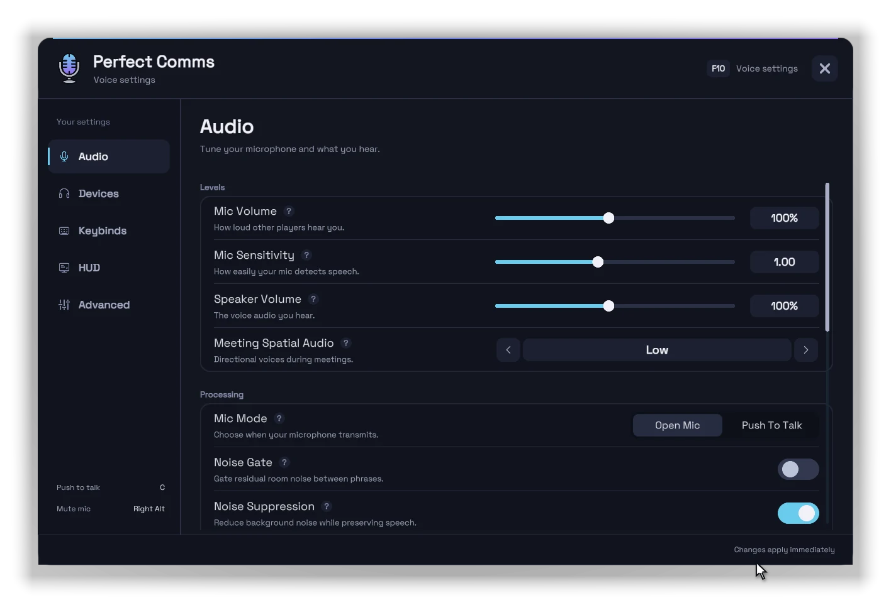
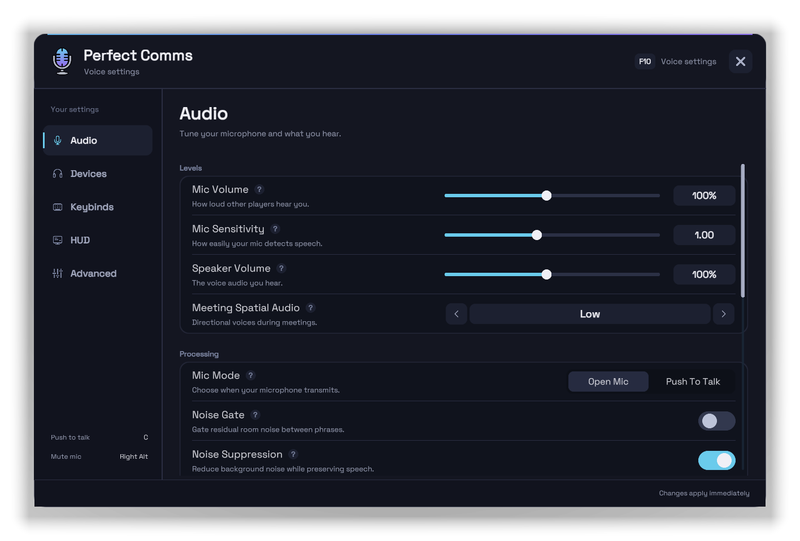
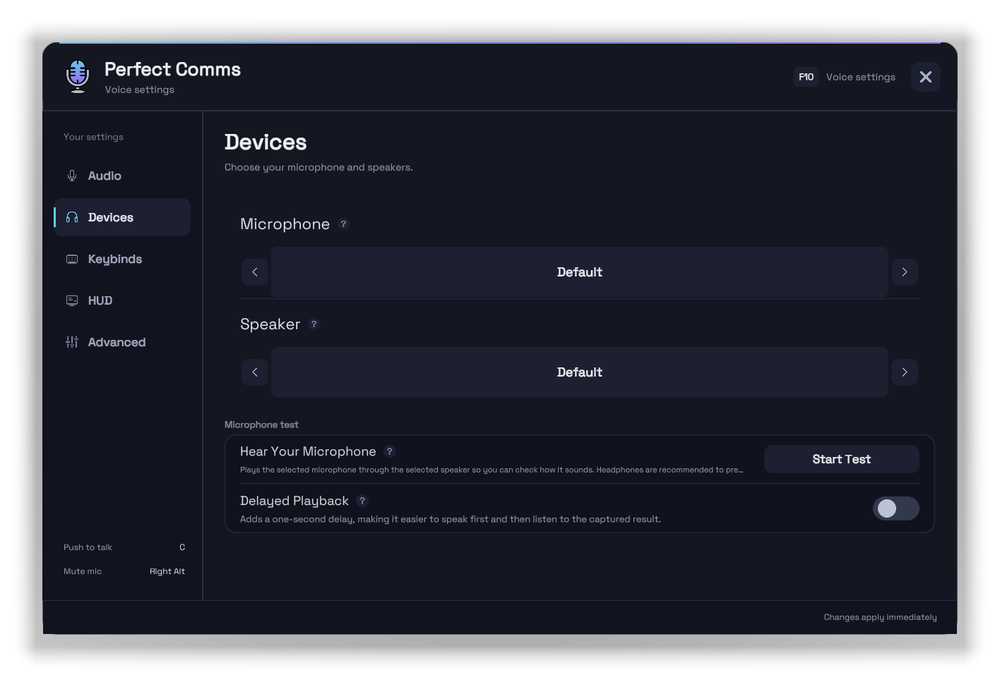
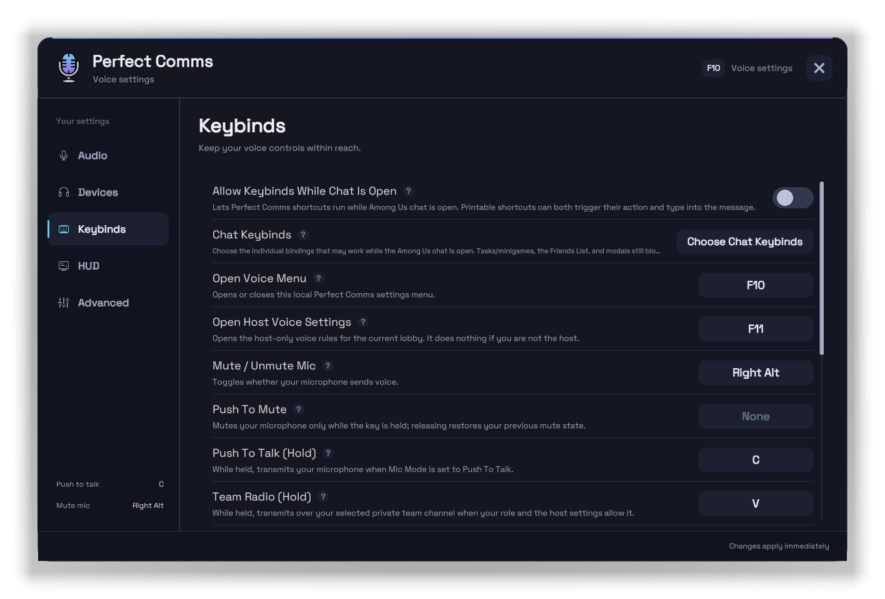
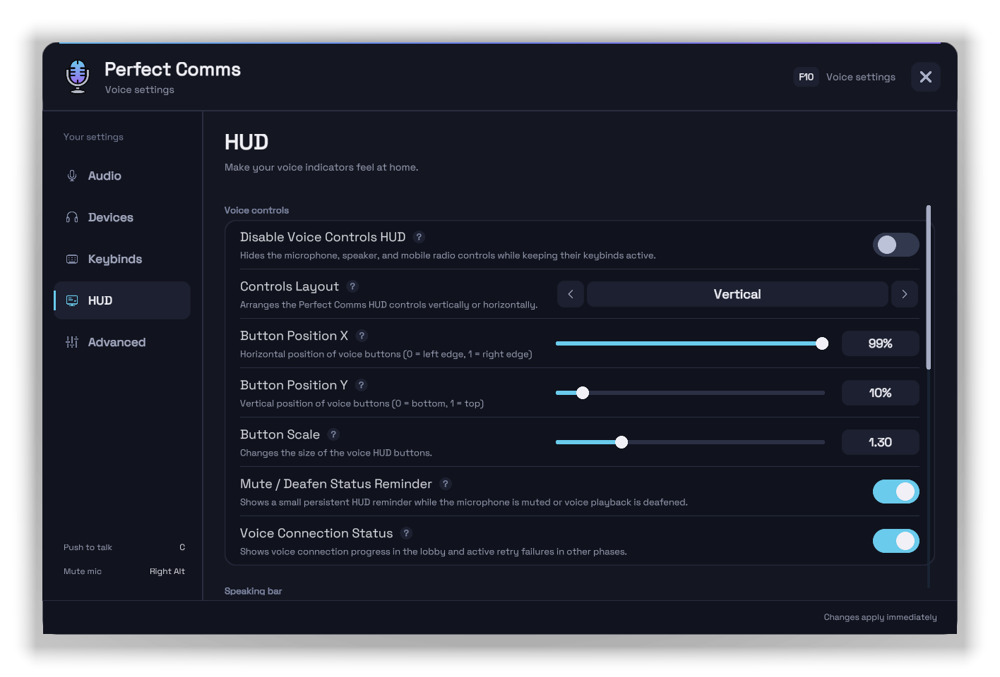
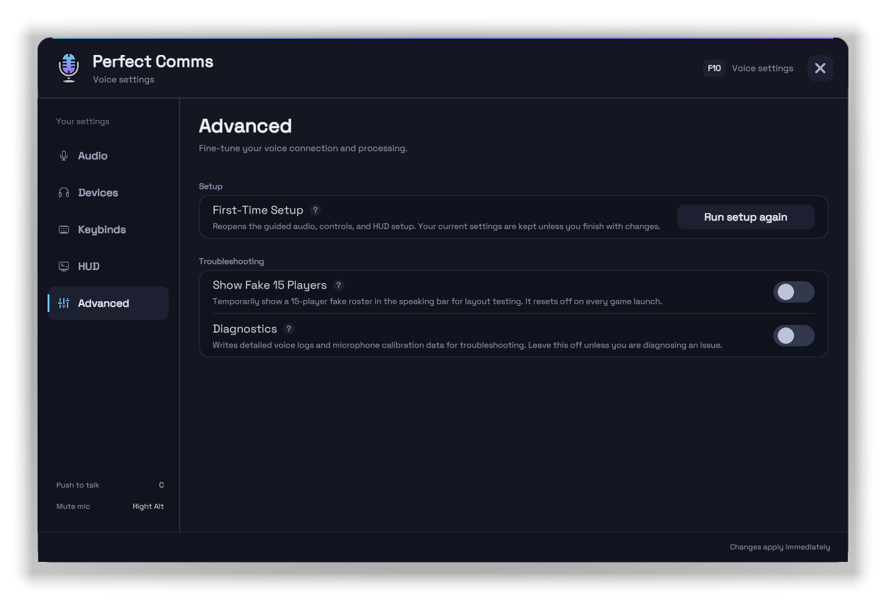

<p align="center">
  
</p>

<h1 align="center">Perfect Comms</h1>

<p align="center">
  <strong>Proximity voice chat built into Among Us.</strong><br>
  No Discord, no mute bots. Hear the players near you, with rules your host sets.
</p>

<p align="center">
  <a href="https://github.com/artriy/Perfect-Comms/releases/latest"></a>
  <a href="https://github.com/artriy/Perfect-Comms/releases"></a>
</p>

<p align="center">
  <a href="#install">Install</a> &nbsp;·&nbsp;
  <a href="#controls">Controls</a> &nbsp;·&nbsp;
  <a href="#settings">Settings</a> &nbsp;·&nbsp;
  <a href="#supported-mods">Supported mods</a> &nbsp;·&nbsp;
  <a href="#for-mod-developers">Mod developers</a>
</p>

<p align="center">
  
</p>

## Features
<table>
  <tr><td><b>Built into the game</b></td><td>Talk through your own mic inside the match. No Discord or mute bots.</td></tr>
  <tr><td><b>Proximity audio</b></td><td>Clear up close and quiet at a distance, with optional wall and vision occlusion.</td></tr>
  <tr><td><b>Host-tuned rounds</b></td><td>Hearing range, ghost and meeting rules, Team Radio, and an optional Meetings &amp; Lobby Only mode.</td></tr>
  <tr><td><b>Role-aware voice</b></td><td>Role mutes, private Team Radio, and muffled hearing with <a href="#supported-mods">supported mods</a>.</td></tr>
  <tr><td><b>Voice lobbies</b></td><td>Find voice-ready public lobbies from the main menu.</td></tr>
  <tr><td><b>Plug and play</b></td><td>A short first-time setup, then every option is one key away (<code>F10</code>).</td></tr>
</table>

## Install

1. Close Among Us.
2. Download `PerfectComms.dll` from the [latest release](https://github.com/artriy/Perfect-Comms/releases/latest).
3. Put it in `BepInEx/plugins`. If your mod or modpack already provides BepInEx, keep it and **don't install another copy over it**.
4. Launch the game and follow the first-time setup.

<details>
<summary><b>No BepInEx yet?</b></summary>
<br>

1. Download **BepInEx 6 Unity IL2CPP** (`Unity.IL2CPP-win-x64`) from the [official build page](https://builds.bepinex.dev/projects/bepinex_be).
2. Extract it into the folder containing `Among Us.exe`.
3. Launch the game once to finish BepInEx setup, then close it and continue from step 2 above.

See the [official IL2CPP installation guide](https://docs.bepinex.dev/master/articles/user_guide/installation/unity_il2cpp.html) for help. Perfect Comms installs beside mods that use Reactor or MiraAPI (such as TOU-Mira) without replacing their loader or dependencies.

</details>

<details>
<summary><b>Android (Starlight tester build)</b></summary>
<br>

Android support is the single managed `PerfectCommsStarlight.dll` tester build. It is not an APK; use it only in an All Of Us staff-approved test or a Starlight beta/local-mod build, following the [Starlight developer testing guide](https://allofus.dev/guides/starlight-dev-guide/#testing). It uses Starlight recording and Unity playback, follows Android's system audio route, and plays with desktop players in the same voice lobby. Open Perfect Comms from the in-game Options menu.

</details>

## Controls

| Key | Action |
| :---: | :--- |
| `Right Alt` | Mute / unmute microphone |
| `Right Ctrl` | Deafen / undeafen |
| Hold `C` | Push To Talk |
| Hold `V` | Team Radio |
| `G` | Cycle Team Radio channel |
| `Shift+B` | Player volumes |
| `F7` | Refresh voice connection |
| `F10` | Voice settings |
| `F11` | Host voice settings |

> [!TIP]
> **Open Mic** is the default: your voice sends when you speak. Switch to **Push To Talk** in **Voice settings > Audio**; it works during task minigames too. Tap `Right Alt` or `Right Ctrl` on their own (not with another key) to mute or deafen; both work while chat is open. Push To Mute, Toggle Open Mic / Push To Talk, and alive/dead volume holds are unbound by default and can be set in **Voice settings > Keybinds**.

<details>
<summary><b>Android touch controls</b></summary>
<br>

- **Open Mic:** tap the microphone button to mute or unmute.
- **Push To Talk:** hold the microphone button while speaking.
- **Team Radio:** tap its button to change channel, hold it to transmit.
- **Deafen:** tap the speaker button. Deafening mutes playback and pauses your microphone.

</details>

## Settings

Click a tab to see that screen exactly as it looks in game.

<details name="settings-tab" open>
<summary><b>Audio</b> &nbsp;·&nbsp; Tune your microphone and what you hear.</summary>
<p align="center"></p>
</details>
<details name="settings-tab">
<summary><b>Devices</b> &nbsp;·&nbsp; Choose your microphone and speakers.</summary>
<p align="center"></p>
</details>
<details name="settings-tab">
<summary><b>Keybinds</b> &nbsp;·&nbsp; Keep your voice controls within reach.</summary>
<p align="center"></p>
</details>
<details name="settings-tab">
<summary><b>HUD</b> &nbsp;·&nbsp; Make your voice indicators feel at home.</summary>
<p align="center"></p>
</details>
<details name="settings-tab">
<summary><b>Advanced</b> &nbsp;·&nbsp; Fine-tune your voice connection and processing.</summary>
<p align="center"></p>
</details>

| Hosts set the match rules | Players set their own audio |
| :--- | :--- |
| Talk distance, falloff, and occlusion | Mic and speaker device |
| Vent, ghost, and meeting voice rules | Open Mic, Push To Talk, and an optional noise gate |
| Team Radio channels | Meeting spatial audio, noise suppression, and echo cancellation (desktop) |
| Role-based mutes (with supported mods) | Per-player volume and HUD layout |

**Recording on Windows:** the optional OBS plugin saves separate per-player or alive/dead voice files next to your recording. [Setup guide](https://github.com/artriy/Perfect-Comms/wiki/Players#obs-recording-integration).

## Supported mods

Perfect Comms works on its own. Supported mods unlock extra voice behavior automatically when they're installed.

| Mod | Voice behavior |
| :--- | :--- |
| **TOU-Mira** | Blackmailer, Jailor, Parasite / Puppeteer, Swooper, and Glitch mutes.<br>Crewpostor impostor voice rules.<br>Medium ghost voice modes.<br>Muffled hearing for Eclipsal, Grenadier, and Hypnotist effects.<br>Team Radio for Impostors, Vampires, and Lovers, with keybind cycling. |

## For mod developers

Add voice behavior to your roles mod **without forking Perfect Comms**: mutes, private routes, persistent host options, concealment-safe overlays, animated colors, and Team Radio on Perfect Comms' own controls and network path. Compile against the reference-only API package; it never copies the runtime into your mod.

```xml
<PackageReference Include="PerfectComms.Api" Version="4.1.7.1" PrivateAssets="all" />
```

```csharp
[BepInDependency("com.edgetel.perfectcomms", BepInDependency.DependencyFlags.SoftDependency)]
// in Load():
PerfectCommsApi.RegisterVoiceRule("com.me.mymod", ctx =>
    ctx.Phase == VoicePhaseKind.Meeting && MyRoles.IsGagged(ctx.Player)
        ? VoiceRuleResult.Mute("Gagged")
        : VoiceRuleResult.Pass);
```

The API package (`4.1.7.1`) is versioned separately and supports Perfect Comms 4.1.7 and later. Players install Perfect Comms themselves; declare it as a soft dependency. Every primitive and copy-paste examples: **[Mod Integration Wiki](https://github.com/artriy/Perfect-Comms/wiki/Mod-Integration)**.

## Credits

- [FangkuaiYa/AmongUs-VoiceChat](https://github.com/FangkuaiYa/AmongUs-VoiceChat)
- [OhMyGuus/BetterCrewLink](https://github.com/OhMyGuus/BetterCrewLink)
- Peer transport: [Pion WebRTC](https://github.com/pion/webrtc)
- Special thanks to [idkimneil](https://github.com/idkimneil), the reason I made this.

<p align="center">
  
</p>

> Perfect Comms is an unofficial mod. It is not affiliated with Innersloth, Among Us, BepInEx, MiraAPI, Reactor, BetterCrewLink, or any supported mods.
