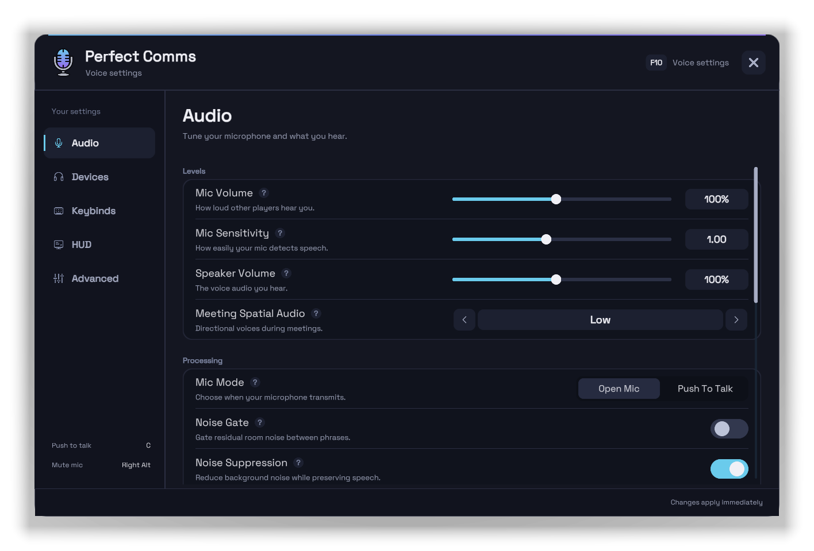
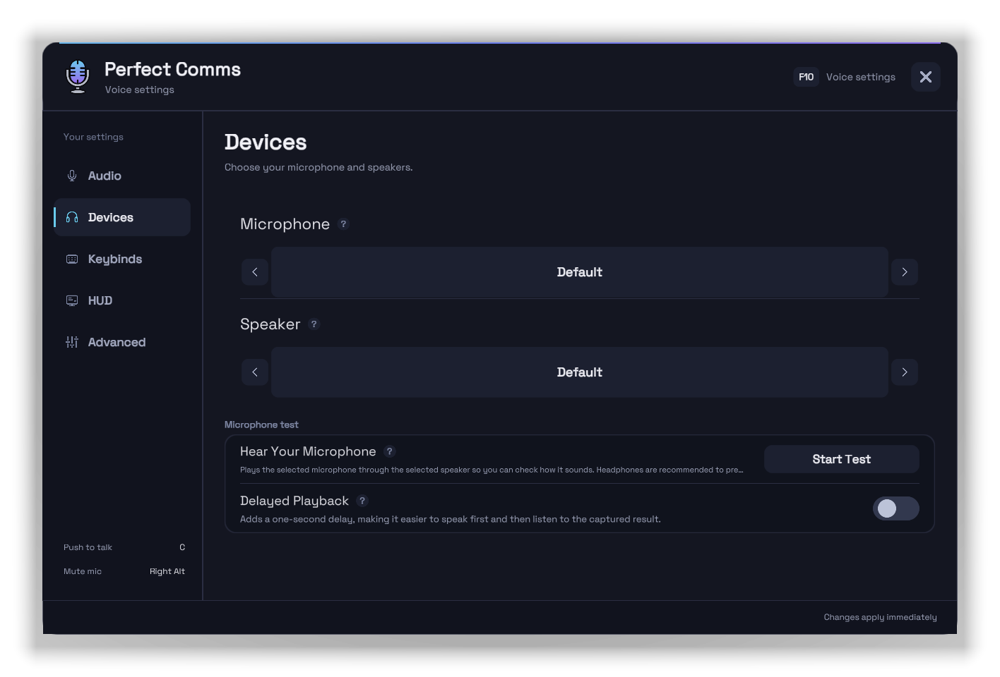
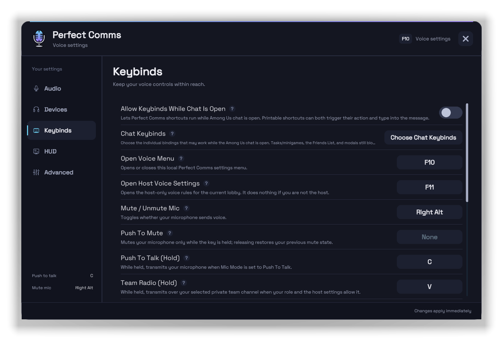
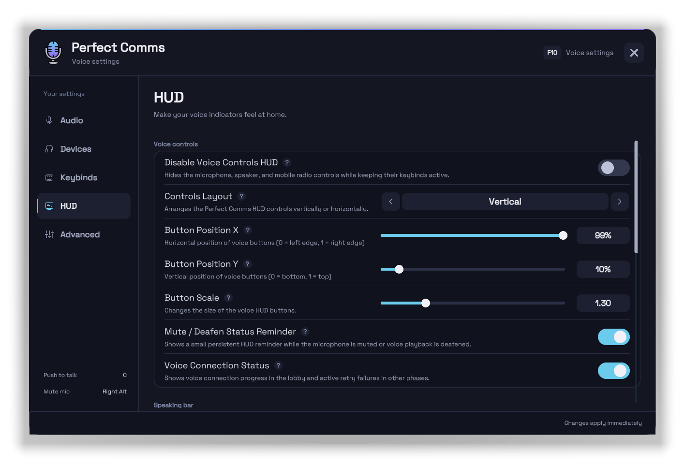
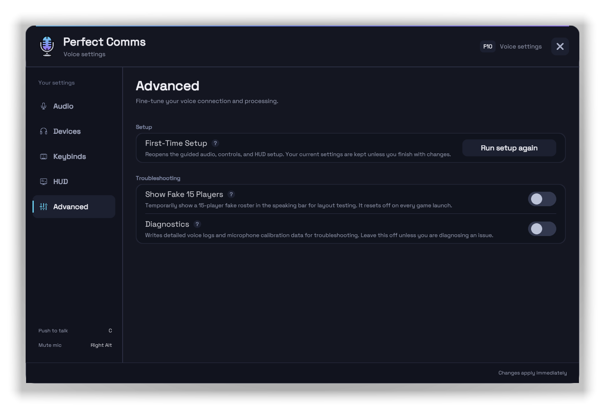

# Voice settings and controls

Open **Voice settings** from the Among Us Options menu, or press <kbd>F10</kbd> on desktop. These settings are local: they change your own microphone, playback, controls, and HUD, not the host's lobby rules.

A new install opens [first-time setup](/guide#first-time-setup); rerun it from **Advanced > First-Time Setup**. Its HUD choices are Top Middle, Middle Right, Middle Left, Compact, Top Left, Top Right, Left Stack, Right Stack, Bottom Center, and Minimal.

## Audio tab

| Setting | Default | What it controls |
| :--- | :---: | :--- |
| **Mic Volume** | 100% | How loudly your mic is sent; does not affect speech detection. |
| **Mic Sensitivity** | 1.00 | How easily quiet speech is detected; higher picks up quieter audio. |
| **Speaker Volume** | 100% | Overall Perfect Comms voice volume you hear. |
| **Meeting Spatial Audio** | Low | Off, Low, or Full stereo spread for Meeting and End Game voices; Team Radio stays centered. |
| **Mic Mode** | Open&nbsp;Mic | **Open Mic** (voice activation) or **Push To Talk**. |
| **Noise Gate** | Off | Removes residual room noise between phrases; off preserves the quietest speech and word endings. |
| **Noise Suppression** | On | Cleans outgoing mic noise. Desktop only. |
| **Stronger Noise Suppression** | Off | Strongest WebRTC suppression level, only while Noise Suppression is on; may make quiet speech less natural. Desktop only. |
| **Echo Cancellation** | On | Reduces speaker audio feeding back into your mic. Desktop only. |
| **Voice Falloff Softness** | 30% | Keeps voices clearer through more of the host's range before fading near the edge; never extends the range. |
| **Start Muted** | Off | Starts each voice session muted. |
| **Start Deafened** | Off | Starts each voice session deafened (playback muted, mic paused). |
| **OBS Compatibility Mode** | Off | Adds a minimized Perfect Comms Audio window for OBS Application Audio Capture; not needed with the OBS plugin. See [OBS Compatibility Mode](/obs#obs-compatibility-mode). |
| **OBS Recording Integration** | Off | Saves separate voice files beside your OBS recording via the optional plugin; excludes your own mic. See [OBS Recording Integration](/obs#obs-recording-integration). |
| **Separate Voice Files** | Per player | Shown while OBS Recording Integration is on. **Per player** or **Alive / dead**; applies to the next recording. |
| **OBS Recording Setup** | - | **Open Guide** opens the OBS setup guide in your browser. |

Ranges: Mic and Speaker Volume 10% to 200%, Mic Sensitivity 0.25 to 2.00, Voice Falloff Softness 0% to 100%.

The OBS rows sit in a **Streaming** group shown only on native Windows (hidden on Android, Wine, and Proton). While OBS Recording Integration is on, a status panel below it shows the recording state.

## Devices tab

- **Microphone** and **Speaker** (desktop only) select devices; **Default** follows the system device. Android playback follows the current audio route.
- A saved device stays listed, with its full name, while temporarily unavailable.
- **Hear Your Microphone** plays your mic through your output so you hear how you sound. Use headphones to avoid feedback.
- **Delayed Playback** adds a one-second delay to that test so you can speak, then listen. It is off each time Voice settings opens, and the test stops when you leave the tab or close settings.

## Keybinds tab (desktop)

Android uses touch controls instead (see [Android touch controls](/settings#android-touch-controls)). A binding can be a keyboard key, mouse button, standalone left/right modifier, or modifier chord. Select a binding and press the new key or chord, or clear it to unbind.

| Action | Default | What it does |
| :--- | :---: | :--- |
| **Open Voice Menu** | <kbd>F10</kbd> | Opens or closes Voice settings. |
| **Open Host Voice Settings** | <kbd>F11</kbd> | Opens host voice rules; host only. |
| **Mute / Unmute Mic** | <kbd>Right Alt</kbd> | Toggles mute in Open Mic; in Push To Talk it only clears a manual mute. |
| **Push To Mute** | Unbound | Mutes while held, then restores the previous mute state. |
| **Push To Talk (Hold)** | <kbd>C</kbd> | Transmits while held when Mic Mode is Push To Talk. |
| **Team Radio (Hold)** | <kbd>V</kbd> | Transmits on the selected eligible team channel while held. |
| **Cycle Team Radio Channel** | <kbd>G</kbd> | Cycles the built-in and mod channels available to you. |
| **Toggle Open Mic / Push To Talk** | Unbound | Switches mic mode. |
| **Toggle Deafen** | <kbd>Right Ctrl</kbd> | Mutes playback and pauses your mic until you undeafen. |
| **Player Volumes** | <kbd>Shift</kbd>+<kbd>B</kbd> | Opens the [player volume mixer](/settings#player-volume-mixer); either Shift works. |
| **Alive Louder / Dead Quieter (Hold)** | Unbound | Applies its alive/dead volume profile while held. |
| **Alive Quieter / Dead Louder (Hold)** | Unbound | Applies its alive/dead volume profile while held. |
| **Refresh Voice Connection** | <kbd>F7</kbd> | Rejoins only your local voice session; 10-second cooldown. |

- Tap <kbd>Right Alt</kbd> or <kbd>Right Ctrl</kbd> alone. A standalone modifier binding does not fire when the key is part of another shortcut. Chords support exact left/right modifiers, and a chord wins over an overlapping plain key.
- A blocked hold or chord must be released before it can fire again.
- Perfect Comms panels, active rebinding, task/minigame screens, the Friends List, the voice lobby info editor, and losing window focus always block keybinds.
- Push To Talk keeps the microphone device open between presses but sends nothing until you hold the key, so your OS may show the mic as in use.

### Chat behavior

**Allow Keybinds While Chat Is Open** (default Off) allows every shortcut while typing. With it off, only the bindings selected in **Chat Keybinds > Choose Chat Keybinds** work in chat; by default that is Mute and Deafen.

New bindings to <kbd>Right Alt</kbd>, <kbd>Right Ctrl</kbd>, or MB4 to MB7 start allowed in chat; other keys start blocked. Rebinding recalculates this, and you can override it. An allowed printable key both triggers its action and types into chat.

### Alive/dead profiles

The settings icon beside either alive/dead binding shows its **Alive Players** and **Dead Players** levels, each 0% to 200% (0% shows **None**):

- **Alive louder / dead quieter:** 200% alive, 50% dead.
- **Alive quieter / dead louder:** 50% alive, 200% dead.

Releasing restores both groups to 100%. Holding both bindings is neutral.

## HUD tab

### Voice controls

| Setting | Default | What it controls |
| :--- | :---: | :--- |
| **Disable Voice Controls HUD** | Off | Hides the mic, deafen, and Android Team Radio buttons; keybinds still work. |
| **Controls Layout** | Vertical | Vertical or horizontal button layout. |
| **Button Position X / Y** | 99% / 10% | Screen position of the voice controls. |
| **Button Scale** | 1.30 | Button size, 0.75 to 3.00. |
| **Mute / Deafen Status Reminder** | On | Small persistent reminder while muted or deafened. |
| **Voice Connection Status** | On | Shows lobby connection progress and retry status in any phase; device warnings still show when off. |

### Speaking bar

| Setting | Default | What it controls |
| :--- | :---: | :--- |
| **Disable Speaking Bar** | Off | Hides the speaking bar and its settings. |
| **Show All Players** | Off | Keeps a slot for every connected player, not only current speakers. |
| **Live Preview** | Off | Shows a 15-player preview while you edit; turns off when you close settings, leave the HUD tab, or restart. |
| **Speaking Bar Position** | Top Middle | Top Left, Top Middle, Top Right, Bottom Left, Bottom Middle, Bottom Right, Middle Left, or Middle Right; manual layout overrides it. |
| **Side Layout** | Single Lane | Left and Right presets without manual layout: one lane or **Wrapped** columns. Top/Bottom Middle always wrap. Guided setup picks Wrapped. |
| **Speaking Bar Name Position** | Auto | Auto, Bottom, Top, Left, or Right. |
| **Speaking Bar Scale** | 100% | Icon and name size, 50% to 225%. |
| **Speaking Bar Backdrop** | On | Translucent backdrop behind the bar. |
| **Speaking Bar Manual Layout** | Off | Replaces the preset with the manual controls below. |

Manual layout adds **Speaking Bar Layout** (Vertical or Horizontal, default Horizontal), **Avatar Facing** (Right or Left, default Right), and **Speaking Bar X / Y** (0% to 100%, default 50% / 85%).

### Meeting overlay

**Meeting Speaking Overlay** (default On) glows the real speaker's meeting card. Task-phase disguises, concealment, and blindness do not affect it once the meeting reveals identities; compatible mods can still hide or reattribute it.

## Advanced tab

- **First-Time Setup > Run setup again** reopens guided setup. Settings change only if you finish with changes; **Use existing settings** keeps everything and marks setup complete.
- **Show Fake 15 Players** fills the speaking bar with a test roster. Hidden while the bar is disabled; resets off each launch.
- **Diagnostics** writes detailed voice and mic-calibration logs. Resets off each launch; leave it off unless investigating a problem.

## Player volume mixer

Press <kbd>Shift</kbd>+<kbd>B</kbd> to open **Player Volumes**: a saved slider per player (0% to 200%), a reset-to-100% action, and a live speaking meter. Only affects what you hear.

## Android touch controls

Android Voice settings has Audio, Devices, HUD, and Advanced tabs, and uses on-screen buttons:

- **Open Mic:** tap the mic button to mute or unmute.
- **Push To Talk:** hold the mic button to speak.
- **Team Radio** (when available): tap to change channel, hold to transmit.
- Tap the speaker button to deafen or undeafen.
